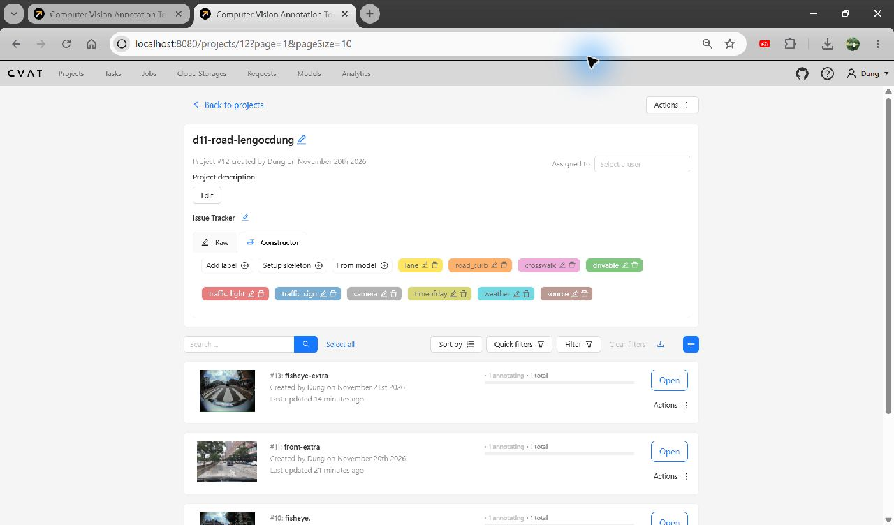
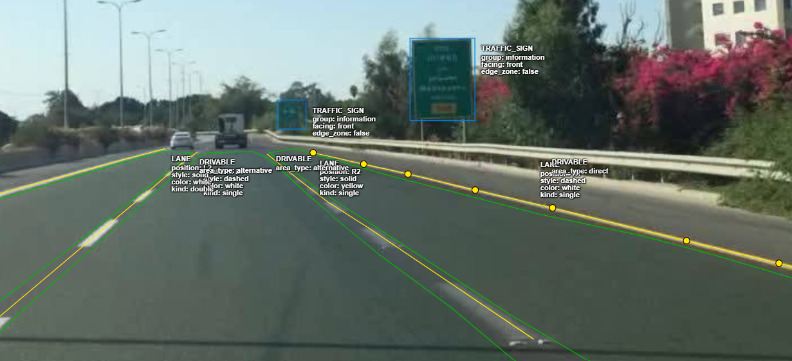
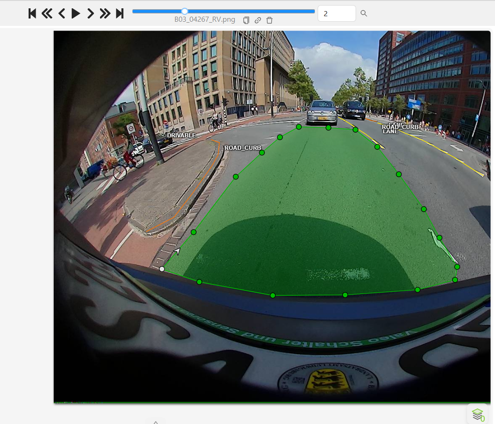
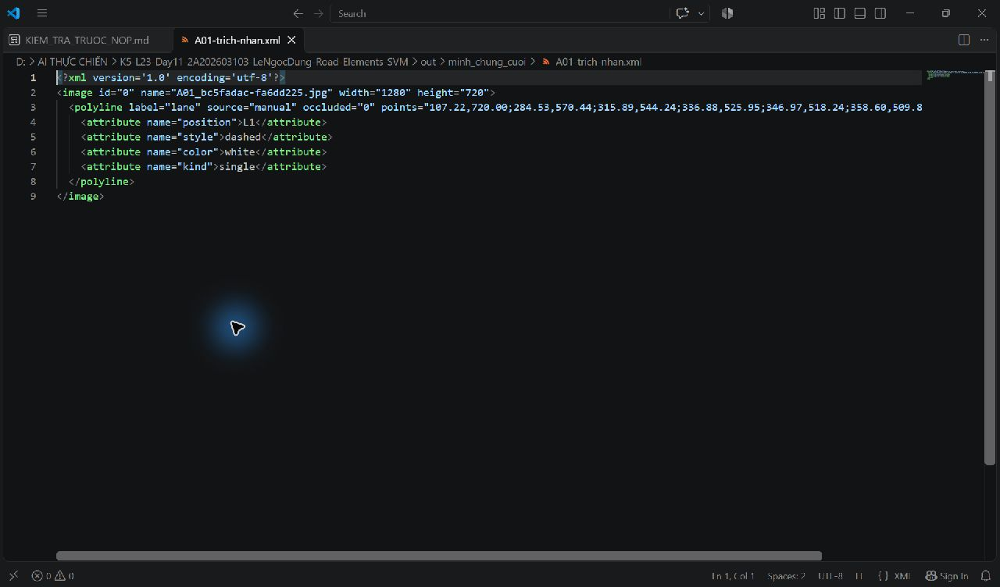

# Báo cáo cá nhân — Ngày 11: Road Elements & SVM

**Họ tên:** Lê Ngọc Dũng 
**Mã học viên:** 2A202603103 
**Project:** d11-road-lengocdung — CVAT Project #12 
**Phiên bản CVAT:** Server 2.82.0; UI 2.82.0 
**Guideline:** Road v1.0, kèm hướng dẫn bổ sung của giảng viên về vạch đôi 
**Lần bàn giao:** revision 1 theo `lengocdung-manifest.json` 
**Ngày hoàn thiện báo cáo:** 21/11/2026 
**Sửa theo QC:** đã sửa trong quá trình hoàn thiện bản bàn giao; chưa tạo revision 2. Bản được kiểm trước sửa và bản chốt được phân biệt tại mục 4–5.

## 1. Kiểm project

| Mục | Kết quả | Ghi chú |
| --- | --- | --- |
| 6 label, đúng kiểu | Đã xác minh | `lane`, `road_curb`: polyline; `crosswalk`, `drivable`: polygon; `traffic_light`, `traffic_sign`: rectangle. |
| Thuộc tính và giá trị | Đã xác minh cấu trúc | Đã mở XML và chạy công cụ kiểm; không có cảnh báo tên label/giá trị thuộc tính ngoài schema. |
| 4 tag ảnh | Đã xác minh | Đủ `camera`, `timeofday`, `weather`, `source` trên cả 28 ảnh; camera khớp tên ảnh. |
| 4 task/job | Đã xác minh | Jobs #9 (front), #11 (front-extra), #10 (fisheye), #13 (fisheye-extra) đều có `state=completed`. |

**Kết thúc polyline:** nhấn N sau khi đặt điểm cuối; vẽ theo hướng từ gần xe ra xa. 
**Đặt tag:** dùng công cụ Tag; chọn label, thêm một tag cho mỗi loại trên từng ảnh, rồi mở Details để kiểm thuộc tính `value`. 
**Lưu nhãn:** Ctrl+S; hoàn tất job trước khi export.

**Quy ước vạch đôi của buổi học:** theo hướng dẫn giảng viên đã được tôi xác nhận trong quá trình làm bài, vạch đôi được vẽ bằng **hai polyline `lane`, cả hai đặt `kind=double`**. Tôi giữ cách gán này tại A01–L2, A04–L1, A11–L1 và A14–L1. Vì checker cảnh báo khi có nhiều lane cùng position, các cảnh báo tương ứng được ghi chú để người chấm đối chiếu; không xóa log hoặc tự gộp hai đường. Ngoại lệ này không áp dụng cho những đường còn mang `kind=single`.

## 2. Số lượng đã gán

| Task | Ảnh | lane | road_curb | crosswalk | drivable | traffic_light | traffic_sign |
| --- | ---: | ---: | ---: | ---: | ---: | ---: | ---: |
| front | 12 | 35 | 10 | 2 | 23 | 38 | 36 |
| front-extra — đã làm 4/4 | 4 | 12 | 1 | 2 | 12 | 16 | 15 |
| fisheye | 8 | 13 | 21 | 10 | 8 | 10 | 11 |
| fisheye-extra — đã làm 4/4 | 4 | 3 | 3 | 4 | 4 | 0 | 0 |
| **Tổng** | **28** | **63** | **35** | **18** | **47** | **64** | **62** |

Tổng cộng **289 shape và 112 tag**. Hai bộ nhãn gồm đủ A01–A16 và B01–B12. B11 có 4 tag và không có shape; ảnh chủ yếu là ô đỗ, không gán vạch ô đỗ thành lane. Điểm thưởng ảnh thêm do giảng viên kiểm, không được suy ra chỉ từ số lượng file.

## 3. Bảng ca khó

| Ảnh | Nhãn | Phân vân giữa | Đã chọn | Lý do / xác nhận |
| --- | --- | --- | --- | --- |
| A01, A04, A11, A14 | lane đôi | Một hay hai polyline | Hai lane, mỗi lane `kind=double` | Theo hướng dẫn riêng của giảng viên trong buổi thực hành. |
| A05 | L1/R1 | Không có vạch sơn / thiếu nhãn | Không vẽ thêm L1/R1 | Coach đã xác nhận không thấy vạch và miễn QC1-02. Hai bên có xe đỗ; không lấy đường bao xe hoặc bó vỉa làm lane. |
| A06 | R1 | Mép bó vỉa / vạch sơn | Không gán R1 giả | Coach đã xác nhận miễn QC1-02; mép bó vỉa được gán `road_curb`. |
| A09 | R1 | Mép đường / vạch sơn | Không gán R1 giả | Coach đã xác nhận miễn QC1-02 do không thấy vạch. |
| A14 | R1 | Không thấy rõ trong cảnh đêm / thiếu lane | Không vẽ thêm vạch suy đoán | Coach đã xác nhận miễn QC1-02. |
| A12 | lane bên phải | L1 / R2 | Sửa `position` từ L1 sang R2 | Đường nằm bên phải R1; bản ZIP bàn giao đã sửa, không thay tọa độ. |
| B11 | Vạch ô đỗ | Lane / ký hiệu ô đỗ | Không gán lane/crosswalk cho ô đỗ | Guideline quy định vạch ô đỗ không gán lane. |
| B02–B05 | Đèn/biển sát rìa | `edge_zone` bật/tắt | Giữ để đối chiếu theo toàn ảnh | Checker còn 8 gợi ý; đây là các ca cần giảng viên đối chiếu, không tự coi đã hết lỗi. |
| B06 | Vạch và vùng lái | Lane, ray, đảo và alternative | Ghi nhận ca khó | Cần đối chiếu chức năng phần đường; không kết luận `alternative` chỉ từ hướng camera. |

Các xác nhận miễn QC1-02 ở A05, A06, A09 và A14 đã được tôi xác nhận đầy đủ ngày 21/11/2026. Số cảnh báo gốc trong manifest vẫn được giữ để truy vết.

## 4. Phiếu QC 1 nhận được và phản hồi

**Bạn kiểm lô của tôi:** Nguyễn Bảo Khánh. 
**Mẫu kiểm:** A01, A06, A12, B02, B03, B06 — **96 nhãn (shape + tag)**. 
**Quyết định nhận được đối với bản trước sửa:** Rework, do lỗi `position` tại A12. Khánh đã xác nhận nội dung phiếu kiểm; tôi đã xử lý lỗi được chỉ ra trong bản bàn giao.

| Mã lỗi / việc | Số lỗi hoặc phạm vi | Đồng ý? | Đã sửa / xử lý? |
| --- | --- | --- | --- |
| QC1-03: lane phía phải A12 mang L1 | 1 lỗi xác định | Có | Đã sửa L1 → R2 trong `lengocdung-front.zip`; giữ nguyên tọa độ. |
| QC1-01: tag thiếu/sai ở các bản trước | A05, A13, A16 | Có | Đã bổ sung/sửa; hiện 28/28 ảnh đủ 4 tag và đúng camera. |
| QC1-03: position ở camera hai bên | B05, B06 | Có | Lane của camera trái/phải đã dùng `other`. |
| QC1-04: chiều polyline | A12, A14 | Có | Bản hiện tại không còn cảnh báo chiều vẽ từ xa về gần. |
| QC1-02: không thấy vạch | A05: L1/R1; A06/A09/A14: R1 | Không thêm vạch giả | Đã có xác nhận miễn của coach; ghi rõ tại mục 3 và 5. |
| QC1-05: nhiều lane do vạch đôi | A01/A04/A11/A14 | Theo hướng dẫn thầy | Giữ hai lane, cả hai `double`; không gộp để làm sạch cảnh báo. |

Sửa A12 được thực hiện trong bản ZIP tổng hợp; bản xuất gốc trên máy được giữ nguyên. Khi xuất lại từ CVAT cần áp dụng cùng thay đổi để không đưa lại giá trị cũ. Xác nhận của Khánh được lưu cho phiếu đã kiểm; không tự thay quyết định của bản trước thành Release cho bản sau sửa khi chưa có kết luận kiểm lại đó.

**Phiếu tôi kiểm cho Khánh:** `lengocdung-qc1-for-nguyenbaokhanh.md`, cùng mẫu 6 ảnh nhưng gồm **103 nhãn**. Phiếu có 1 lỗi nặng, 2 lỗi chính xác định và quyết định Rework theo luật của bài. Hai mẫu số 96 và 103 được dùng riêng cho hai lô, không hoán đổi.

## 5. Kiểm file export và manifest

### 5.1. Mở lại và đối chiếu số shape

| File | Mở lại được? | Số shape ảnh 1 (job / file) | Số shape ảnh 2 (job / file) | Tag camera có trong XML? |
| --- | --- | --- | --- | --- |
| `lengocdung-front.zip` | Có; ZIP/XML hợp lệ | A01: **10 / 10** | A02: **8 / 8** | Có trên cả 16 ảnh |
| `lengocdung-fisheye.zip` | Có; ZIP/XML hợp lệ | B01: **6 / 6** | B02: **11 / 11** | Có trên cả 12 ảnh |

Số shape của job được đối chiếu trực tiếp từ dữ liệu CVAT ngày 21/11/2026; không tính tag vào cột shape. Hai ZIP dùng **CVAT for images 1.1**, mỗi ZIP chỉ có `annotations.xml`, không chứa ảnh. Tên ảnh giữ nguyên. Core và extra được tổng hợp; image id được đánh lại để không trùng.

Manifest revision 1 đã được tạo bằng công cụ của bài và đối chiếu SHA256 với hai ZIP hiện tại. `contains_images=false` ở cả hai file. Không thay số cảnh báo trong manifest bằng kết luận kiểm tay.

### 5.2. Thời điểm export gốc (giờ Việt Nam)

| Task | Thời điểm ghi trong metadata CVAT |
| --- | --- |
| front | 21/11/2026 11:20:27 |
| front-extra | 21/11/2026 11:19:59 |
| fisheye | 21/11/2026 11:20:15 |
| fisheye-extra | 21/11/2026 11:19:44 |

Bản ZIP tổng hợp được cập nhật thuộc tính A12 sau các thời điểm export trên. Thời điểm tạo manifest của bản bàn giao là `2026-11-21T04:43:39+00:00` (11:43:39 giờ Việt Nam).

### 5.3. Kết quả lint và xử lý ngoại lệ

Kết quả nguyên trạng: **21 cảnh báo = 5 nặng + 16 chính + 0 nhẹ**. Đây là cảnh báo của lint, không phải điểm số hoặc tỉ lệ lỗi QC chéo.

| Nhóm | Số cảnh báo | Ảnh / đối tượng | Cách xử lý |
| --- | ---: | --- | --- |
| QC1-02: không thấy vạch | 5 | A05 thiếu L1/R1; A06, A09, A14 thiếu R1 | **Coach đã xác nhận miễn**; không vẽ thêm vạch không tồn tại. |
| QC1-05: vạch đôi có hai lane | 4 | A01–L2, A04–L1, A11–L1, A14–L1 | Chú thích theo hướng dẫn thầy: hai lane, mỗi lane double. |
| QC1-05: trùng position ở đường single | 3 | A08–L1, A13–R1, A15–R1 | Giữ trong danh sách để người chấm kiểm đường bị tách hay thay đổi kiểu sơn; không áp dụng ngoại lệ double. |
| QC1-11: edge_zone | 8 | B02: 1; B03: 4; B04: 1; B05: 2 | Cần đối chiếu vị trí tâm hộp trên toàn ảnh theo quy ước bán kính. |
| QC1-11: ít điểm trên cung | 1 | B09, một lane có 3 điểm | Cần kiểm hình học thực tế; không thêm điểm tùy tiện chỉ để hết cảnh báo. |

Năm cảnh báo nặng đều thuộc ngoại lệ không thấy vạch đã được coach xác nhận. Các cảnh báo khác còn hiển thị trung thực để BTC/coach đối chiếu; chưa có GT để xác nhận độ lệch 5 px hoặc tính điểm rubric.

## 6. Ảnh chụp màn hình

### 6.1. Labels của project

### 6.2. Ảnh front A01 trong quá trình gán nhãn

### 6.3. Ảnh fisheye B03 với đường polyline theo cung

### 6.4. Trích XML thật có polyline lane

Ảnh 6.1–6.3 là ảnh chụp giao diện trong quá trình thực hành; số lượng và thuộc tính bản bàn giao được xác định từ hai ZIP/manifest hiện tại. Ảnh 6.4 chụp trình soạn thảo mở một đoạn XML trích trực tiếp từ file bàn giao, không phải nhãn tạo giả. Bốn ảnh là minh chứng kèm báo cáo; hai ZIP nhãn không kèm ảnh dataset gốc.

## 7. Tự đánh giá

**Lỗi tôi cần chú ý nhất là QC1-03 — vị trí lane.** Tôi từng giữ nhầm giá trị mặc định khi gán đường bên phải ở A12, và từng chưa đổi về `other` cho camera hai bên. Cách tránh ở buổi tiếp theo là xác định loại camera trước khi vẽ, sửa thuộc tính ngay sau mỗi polyline và rà lại toàn bộ position trước export.

Tôi cũng đã sửa các tag thiếu/sai camera ở A05, A13, A16; kiểm lại thời tiết A05/A06 và chiều polyline A12/A14. Vạch đôi được giữ theo hướng dẫn thầy, thay vì gộp hai đường chỉ để hết cảnh báo.

**Liên hệ với model:** lane mang thông tin vị trí và hình học để mô hình học quan hệ giữa xe với các vạch làn. Nếu vạch bên phải bị gán L1, mô hình có thể học sai phía của làn; tôi đã sửa trường hợp này thành R2. Nếu ảnh front bị gán camera fisheye, dữ liệu có thể bị phân nhóm sai khi huấn luyện hoặc đánh giá; vì vậy tôi đã sửa tag camera của A13 về `front`.

Tôi sử dụng trợ lý AI để đọc tài liệu, kiểm cấu trúc XML, thống kê nhãn, hỗ trợ rà ảnh và soạn báo cáo/QC; các xác nhận của coach và bạn kiểm được ghi theo thông tin thực tế. Tôi không dùng bài học viên khác làm GT và không tự công bố điểm khi chưa có kết quả chấm.

## 8. Tùy chọn — Từ polyline đến đích row-anchor

Chưa thực hiện hoạt động tự tính và đối chiếu row-anchor với bạn kiểm. Phần này không tính điểm theo rubric; không điền số liệu khi chưa đo.
